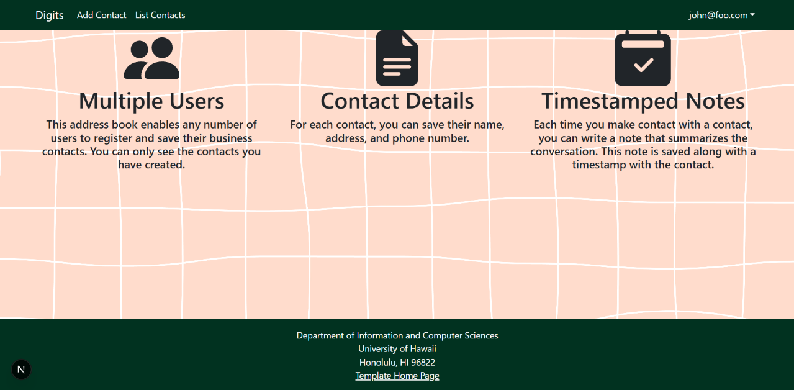
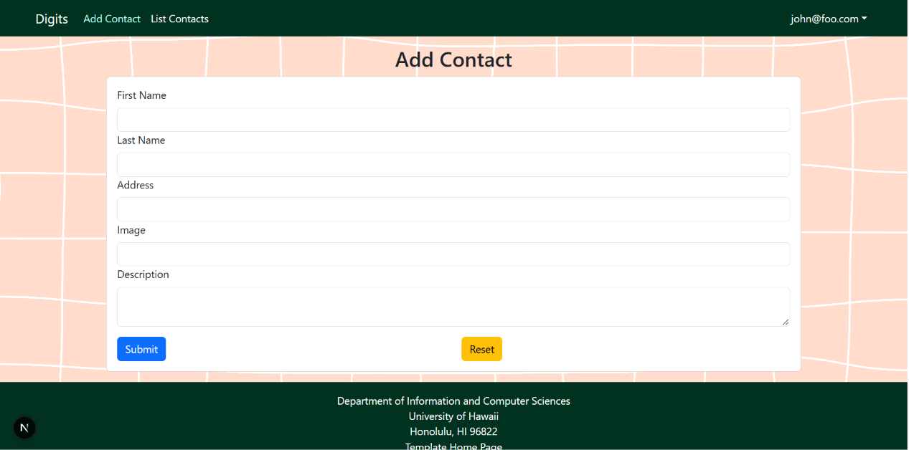
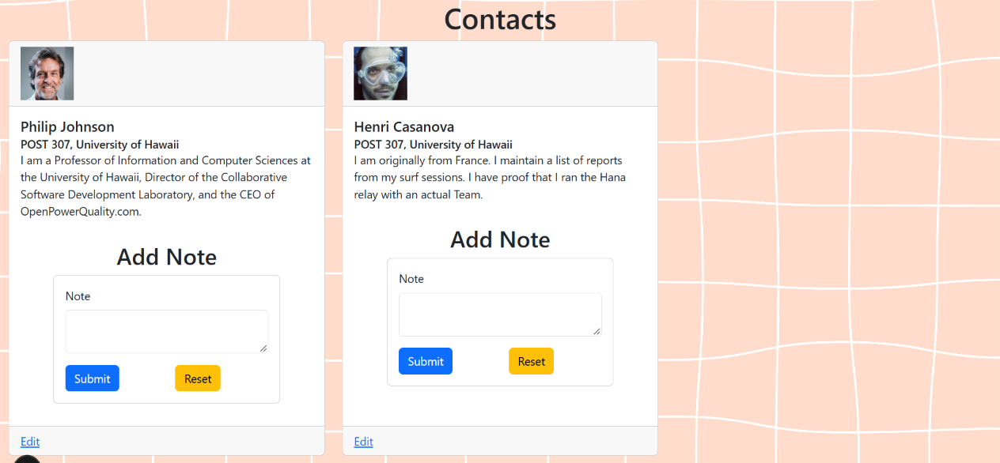
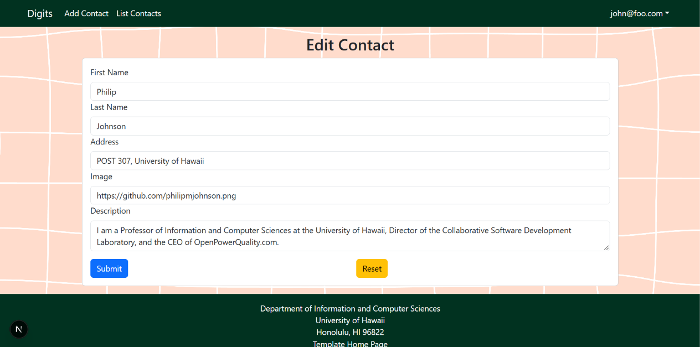

Digits is a Next.js application that allows users to manage their contacts by adding new people, viewing contact profiles, writing notes, and editing existing contacts.

## Installation

To run Digits locally, you will need to have [Node.js](https://nodejs.org/) and [Git](https://git-scm.com/) installed.

1. **Clone the repository**

   Open a terminal and run the following command:

   ```bash
   git clone https://github.com/your-username/digits.git
   ```

2. **Navigate to the project directory**
    ```bash
    cd digits
    ```

3. **Install dependencies**

   ```bash
   npm install
   ```

4. **Set up environment variables**

   Create a `.env` file in the root directory and add the environment variables required by the application.

5. **Set up the database**

   Configure your database connection and run the Prisma migrations:

   ```bash
   npx prisma migrate deploy
   ```

6. **Run the application**

   ```bash
   npm run dev
   ```

7. **Open the application**

   Navigate to [http://localhost:3000](http://localhost:3000) in your browser to access Digits.
   

After opening and logging in to the application, users will be directed to the landing page shown below. From here, they can navigate through the application and access the available features.



## Adding a Contact

To add a new contact, click on Add Contact. This will take you to the form shown below.



Fill out the form with the contact's first name, last name, address, image, and a short description. Once all the information has been entered, click Submit to add the contact to the account.

## Viewing a Contact

After submitting a contact, the new entry will appear on the List Contacts page, as shown below.



On this page, users can view their submitted contacts, write notes about each person, and access options to edit their contact profiles.

## Editing a Contact

To update an existing contact, select the edit option on their profile. This will open the edit page, shown below, where users can make changes to the contact's information and save their updates.


